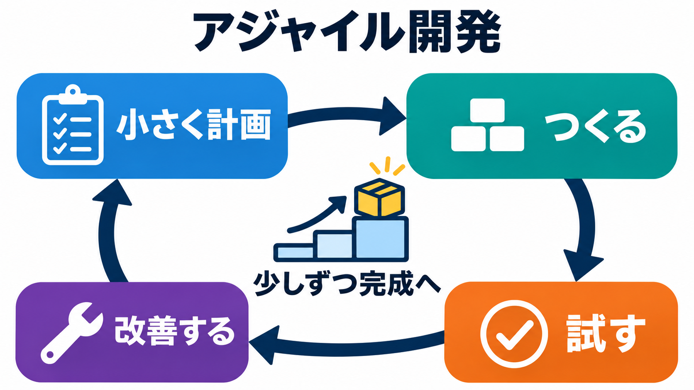
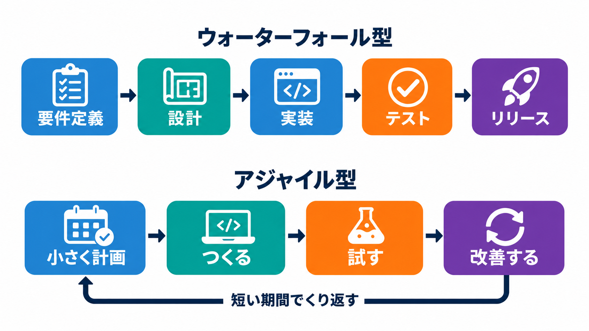

# はじめに

「アジャイル開発で進めます」——現場に入ると当たり前のように飛んでくる言葉ですが、最初は正直よくわからないですよね。

この記事は、**アジャイル開発を初めて聞いた人向けの超入門**です。難しい用語はできるだけ使わず、図とたとえ話で「要するにどういうことか」をつかめるようにまとめました。

**対象読者**

- これからエンジニアになる人、なったばかりの人
- チームに入ったら「スプリント」「朝会」「振り返り」という言葉が飛び交っていて困惑している人
- 非エンジニアだけど、開発チームと仕事をすることになった人

# アジャイル開発を一言でいうと

**「小さく作って、見せて、直す」を何度も繰り返す開発のやり方**です。

図のとおり、やることはこの4つのループです。

1. **小さく計画** — 全部ではなく「次の1〜2週間でやる分」だけ決める
2. **つくる** — 決めた分だけ作る
3. **試す** — 動くものを実際に見て・触って確かめる
4. **改善する** — 感想や気づきをもとに、次の計画に活かす

これを回すたびに、製品が**少しずつ完成に近づいていく**。それがアジャイルです。

# たとえ話:コース料理と、一品ずつ出すお店

ウォーターフォール(従来型)とアジャイルの違いは、料理にたとえるとわかりやすいです。

**ウォーターフォール = フルコースを最後に一括で出すお店**

お客さんに最初に全部の希望を聞いて、厨房にこもって、数ヶ月後にフルコースをドーンと出します。もし味の好みを聞き間違えていたら……全部作り直しです。

**アジャイル = 一品ずつ出して、味見してもらうお店**

まず前菜を出して、反応を見る。「もうちょっと薄味がいい」と言われたら、次の皿から直す。お客さんの好みとズレたまま最後まで突き進むことがありません。

# ウォーターフォールとの違いを図で見る

| | ウォーターフォール | アジャイル |
| --- | --- | --- |
| 進め方 | 一直線(後戻りしにくい) | ループ(毎回軌道修正できる) |
| 動くものが見られるのは | 最後 | 1〜2週間ごと |
| 要望の変更 | 苦手(手戻りが大きい) | 得意(次のループで反映) |
| 向いているもの | 要件が最初から固まっているもの | 作りながら正解を探すもの |

:::note info
ウォーターフォールが「古くてダメ」というわけではありません。要件が完全に固まっている(例:法制度対応)なら、一直線で進む方が速いこともあります。**「どちらが優れているか」ではなく「何を作るかで使い分ける」が正解**です。
:::

# スプリント:アジャイルの1ループ

この「計画→つくる→試す→改善」の1ループを、**スプリント**と呼びます(1〜2週間で設定するのが一般的です)。

スプリントの中では、こんなイベント(セレモニーと呼びます)が行われます。

| セレモニー | いつ | 何をする |
| --- | --- | --- |
| スプリントプランニング | スプリントの最初 | 今回の1〜2週間で「何をどこまでやるか」を決める |
| デイリー(朝会/夕会) | 毎日15分 | 進捗と困りごとを共有する |
| スプリントレビュー | スプリントの最後 | できたものを実際に動かして見せる |
| レトロスペクティブ(振り返り) | スプリントの最後 | やり方自体を改善する(「もっとこうすれば良かった」を次に活かす) |

ポイントは、**製品だけでなく「チームの働き方」も毎回改善する**こと。振り返り(レトロスペクティブ)があるおかげで、チーム自体がスプリントごとに強くなっていきます。

ちなみに毎日の共有会は「朝会」が定番ですが、私のいたチームでは夕会にしていました。その理由と効果はこちらの記事に書いています。

https://qiita.com/Munise/items/55751d6f5ccb4c5ea96c

# 用語ミニ辞典

現場で飛び交う用語を、一言ずつで。

| 用語 | 一言でいうと |
| --- | --- |
| スプリント | 「計画→つくる→試す→改善」の1ループ(1〜2週間) |
| バックログ | やることリスト。優先度順に並んでいる |
| ストーリーポイント | タスクの大きさの見積もり(時間ではなく相対的なサイズ) |
| ベロシティ | チームが1スプリントで進める量の実績値 |
| スクラム | アジャイルを実践するための代表的なフレームワーク |
| カンバン | タスクを「未着手/作業中/完了」で見える化するやり方 |
| スクラムマスター | スプリントがうまく回るよう支援する役割 |
| プロダクトオーナー | 「何を作るか」の優先順位に責任を持つ役割 |

# よくある誤解3つ

**誤解1:「アジャイル=計画しない」**

逆です。アジャイルは**毎スプリント計画します**。「最初に1回だけ計画する」のではなく「短い間隔で何度も計画し直す」が正しいイメージです。

**誤解2:「アジャイル=速い」**

アジャイルの「Agile(俊敏)」は、作業スピードのことではなく、**方向転換が速い**という意味です。間違った方向に全力疾走しないための仕組みです。

**誤解3:「ドキュメントを書かなくていい」**

アジャイルの価値観は「包括的なドキュメントよりも動くソフトウェアを」ですが、これは「ドキュメント不要」ではなく「**ドキュメントのために開発を止めない**」という優先順位の話です。必要なものは書きます。

# まとめ

- アジャイル=**「小さく計画→つくる→試す→改善」のループ**を回して、少しずつ完成に近づける開発
- ウォーターフォールとの最大の違いは、**動くものを早く・何度も確認できる**こと
- 1ループ=スプリント(1〜2週間)。中では朝会(夕会)・レビュー・振り返りを回す
- アジャイルは「速い」ではなく「**方向転換が速い**」

まずはこの図のループだけ頭に入れておけば、現場の会話にはついていけます。わからない用語が出てきたら、この記事の辞典に戻ってきてください。

質問があればコメントでどうぞ。現場での実践の工夫も、別の記事で書いていきます。
