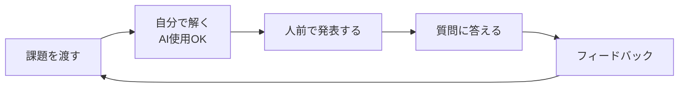

# はじめに

前職で、未経験メンバー2人を含む6人の開発チームをリードしていました。この記事は、そこで実践していた未経験エンジニアの育成方法の話です。

やり方はシンプルです。

**課題を渡して、発表させる。**

「作らせて終わり」にしないこの一手間が、AI時代の今こそ一番効くと思っているので、理由とやり方をまとめます。

**対象読者**

- 未経験・ジュニアメンバーの育成を任されている人
- 「AIがあるのに、何をどう教えればいいんだろう」と悩んでいる先輩エンジニア
- 育てられる側の未経験エンジニア(自分の学習にそのまま応用できます)

# AI時代の育成には、新しい問題がある

昔の未経験者は「動くものが作れない」ことで悩みました。今は逆です。

**AIに聞けば、動くものは作れてしまう。**

ChatGPTやClaudeにエラーを貼れば直してくれるし、「○○を作って」と言えばコードが出てきます。未経験でも、見た目にはタスクが完了する。

でもここに罠があります。

- 動くものはできた。**でも、なぜ動くのかは説明できない**
- エラーは消えた。**でも、何が原因だったのかは知らない**
- 「できました!」の積み重ねで、**「できたつもり」の期間だけが伸びていく**

AIの出力はすべてが正しいわけではないので、間違いに気づける人がチームに必要です。ところが「できたつもり」のまま育つと、間違いに気づく力がいつまでも育たない。これがAI時代の育成の問題です。

# やっていたこと:課題を渡して、発表させる

この問題への対策として、うちのチームでは育成をこの流れで回していました。

1. **課題を渡す** — うちでは、未経験2人にフロントエンドとバックエンドを分担してもらい、**2人で1つの画面(または機能)を作る**課題にしていました。既存のプロダクトという「実物」があるので取り組みやすく、**既存コードを読むこと自体が勉強になる**のもポイントです
2. **解かせる(AI使用OK)** — AIに聞くのは禁止しない。実務でも使うものなので、むしろ使い方ごと学んでもらう
3. **発表させる** — できたものを、本人の口で説明してもらう。「何を作ったか」「どう動くのか」「どこで詰まって、どう解決したか」。コツは、**「いつまでにできるか」を最初に本人と決めて、発表の時間を先に確保しておく**こと。期限と発表の場が先に押さえてあるので、学習がずるずる後回しになりません
4. **質問に答えてもらう** — 聞いている側から「ここはなぜこう書いたの?」と質問する
5. **フィードバックを返す** — コードレビューと発表が終わったら、必ずフィードバックを渡す。良かった点、伸ばすところ、そして詰まった箇所は「次までにここを調べてみよう」という**次の課題**に変換する。これで1周が終わり、次のループにつながります

ポイントは、**完成がゴールではなく、発表がゴール**だということです。

# なぜ「発表」がそんなに効くのか

## 1. AIに頼った部分は、発表で必ず詰まる

自分で理解して書いたコードは説明できます。AIの出力を貼っただけのコードは、説明できません。

つまり発表させると、**理解している部分と「できたつもり」の部分が、その場で見える化される**んです。コードを眺めてレビューするより、はるかに早く正確に理解の穴が見つかります。

## 2. 「説明できる状態にする」が学習そのものになる

発表があると分かっていると、メンバーは発表前に自分で調べ直します。「AIがこう書いたけど、これ何だろう」を放置できなくなる。**説明できるようになるまでの調べ直しが、実は一番の学習**です。

## 3. チームのルールと一本につながる

うちのチームには「**AIが書いたコードも、自分で理解して説明できること**」というルールがありました(詳しくは別記事に書きます)。発表の場は、このルールのトレーニングそのものです。普段のPRレビューで「説明して」と言われても詰まらない人が育ちます。

## 4. 聞いている側も育つ

未経験メンバーが2人いたので、お互いの発表を聞き合う形になります。人の詰まりポイントは自分の詰まりポイントでもあるので、1人の発表で2人分の学習になります。

# AIには何を手伝わせるか

「育成でAIを使う」というと本人の学習補助を思い浮かべますが、**育てる側こそAIを使えます**。

- **課題づくり** — 「React初心者向けに、useStateとuseEffectを使う練習課題を、難易度を3段階で」のように、本人のレベルに合わせた課題をAIに量産させる。育成で一番時間がかかる「ちょうどいい課題を考える」が一瞬で終わります
- **発表への質問づくり** — 提出されたコードをAIに渡して「このコードの理解度を確かめる質問を5つ」と出させる。質問の引き出しが増えるので、発表の場が深くなる
- **詰まりの事前予測** — 課題をAIに見せて「初心者がこの課題で詰まりやすいポイントは?」と聞いておくと、フォローの準備ができる

逆に、**発表を聞いて理解度を判断するところは人間の仕事**です。表情や言葉の詰まり方から「本当にわかっているか」を見るのは、チームの状態を知っている人間にしかできません。

# 注意点

- **詰まりを責めない** — 発表で詰まるのは失敗ではなく、学習ポイントが見つかった成功。詰まった箇所を「じゃあ次までにここを調べてみよう」に変換するのがリーダーの仕事です。責める空気が一度でもできると、メンバーはAIの出力を丸暗記して発表を乗り切ろうとし始めます(本末転倒)
- **発表のハードルは低く** — 資料づくりは不要。画面を共有して口で話すだけ。準備に時間がかかる形式にすると、発表自体が負担になって続きません
- **AIの使用を隠させない** — 「AIに聞いたら×」にすると、こっそり使って説明だけ暗記するようになります。「AIに聞くのはOK、説明できないのはNG」と線を引く方が健全です

# まとめ

- AI時代の未経験者は「動くものは作れるのに、わかっていない」**できたつもり**状態になりやすい
- 対策は「**課題を渡して、発表させる**」。AIに頼った部分は発表で必ず詰まるので、理解の穴が見える化される
- 完成がゴールではなく、**説明できることがゴール**
- AIは育てる側の武器にもなる(課題づくり・質問づくり・詰まり予測)。ただし理解度の最終判断は人間の仕事

「作らせる」だけなら、もうAIがやってくれます。人を育てるなら、「説明させる」です。

同じように未経験メンバーを育てている方の工夫も、ぜひコメントで教えてください。
